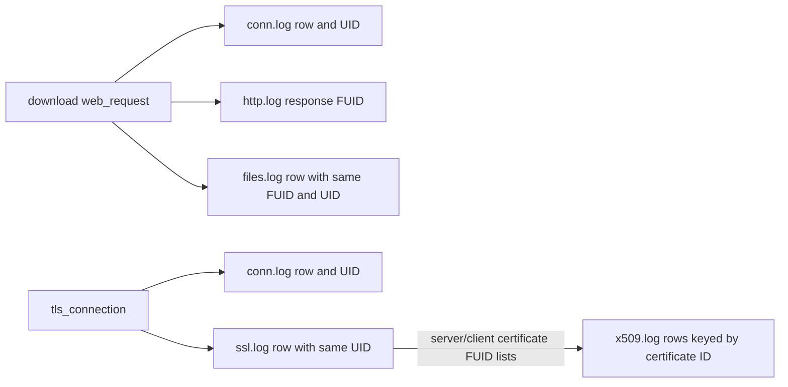

# Phase 4 Planning: Zeek File and TLS Certificate Logs

## Purpose

Phase 4 extends the existing Zeek output family with `files.log`, `ssl.log`, and `x509.log`. It reuses the source-neutral
enrichment introduced in Phase 3 and the existing `conn.log` flow identity. The phase adds one canonical HTTP download
fixture and one canonical TLS handshake fixture so each new stream has a clear source event and correlation path.

Status: planned; implementation has not started.

## Goals

- Generate native-style Zeek TSV for `files.log`, `ssl.log`, and `x509.log` under
  `logs/zeek-sensor-01/zeek/`.
- Preserve the existing `zeek` output family and manifest conventions.
- Keep source-neutral download, TLS, and certificate facts on expanded events or their typed contexts; keep Zeek IDs,
  field names, and TSV rendering inside the Zeek writer.
- Link `files.log` and `ssl.log` to the correct `conn.log` row, and link X.509 certificate records to TLS records by
  certificate identifier.
- Keep output deterministic and avoid implying that synthetic metadata represents packet capture, payload extraction,
  or cryptographic validation.

## Scope and Boundaries

In scope:

- The existing HTTP archive download produces a `files.log` record.
- A new TLS 1.2 scenario produces `conn.log`, `ssl.log`, and `x509.log` records.
- A TLS 1.3 handshake can produce `ssl.log` when its modeled handshake facts are available, but it does not get
  synthetic certificate records by default.
- Add the three streams to the Zeek sensor profile and emit only streams with records. Report requested/configured
  streams with no records through the existing manifest omitted-stream mechanism.
- Add YAML and Python authoring, validation, output, manifest, documentation, and regression coverage needed for the
  new activity.

Out of scope:

- PCAP generation, payload capture, file extraction, malware scanning, or real TLS handshakes.
- Calculating real certificate hashes from DER, validating certificate chains, or checking trust/revocation.
- `ocsp.log`, JA3/JA3S, `pe.log`, TLS decryption, application logs inside HTTPS, and additional Zeek packages.
- New output families or host-side log families.
- Emitting `http.log` for encrypted HTTPS transactions when no plaintext HTTP event is modeled.

## Recommended Design Decisions

1. Keep one `zeek` output family. Extend `profile-zeek-only` with the six streams `conn.log`, `dns.log`, `http.log`,
   `files.log`, `ssl.log`, and `x509.log`; the writer emits a configured stream only when it has records.
2. Treat `conn.log` as the network-flow anchor. `files.log` and `ssl.log` reuse its UID and four-tuple.
3. Treat `x509.log` as certificate-scoped. Its certificate `id`/FUID is referenced by the server or client certificate
   chain in `ssl.log`; an X.509 row does not carry the connection UID. Do not add a fake UID to make its join look like
   the other streams.
4. Derive an HTTP file record only for a successful download-classified `web_request` with a filename and a known
   response size. Reuse the same deterministic FUID in `http.log` response file references and `files.log`.
5. Emit only certificate metadata explicitly present in the source-neutral TLS event. Use a TLS 1.2 fixture for
   `x509.log` coverage because a passive Zeek sensor generally cannot observe TLS 1.3 certificate messages. Do not
   infer a certificate from SNI, the service hostname, or the TLS version.
6. Add a source-neutral `svc-web-https` service on TCP port 443 for the TLS fixture. Model its application protocol as
   HTTPS; map it to Zeek's `ssl` service value inside the Zeek writer.
7. Use the existing Phase 3 native TSV profile and version targets (Zeek 8.2.x and 8.0.x LTS). Confirm the exact
   field set against the selected Zeek `Files::Info`, `SSL::Info`, and `X509::Info` declarations before freezing
   schemas; policy-loaded or package-added columns stay out of the MVP schemas.
8. For the first profile, use deterministic run-level certificate identity and deduplication keyed by the authored
   certificate fingerprint. Do not model Zeek's cluster-specific certificate cache or time-based relogging.

## Data and Record Relationships



The TLS event should parent to its `network_connection`. TLS and certificate detail must not be inferred from the
separate download request. The initial TLS fixture is TLS-only and does not imply an observable HTTP request.

## Proposed Source-Neutral Model Work

The taxonomy draft reserves `tls_connection`, but the runtime model and YAML pipeline do not implement it yet. Phase 4
should implement the event and add typed context for the facts needed by output families:

- `TlsContext`: negotiated TLS version, cipher suite, elliptic curve, server name, ALPN/next protocol, resumed flag,
  handshake-established flag, and optional observed server/client certificate chains.
- `CertificateContext`: authored certificate fingerprint, version, serial, subject, issuer, validity bounds, key and
  signature algorithms, key type/length, optional exponent, DNS/IP subject alternative names, basic constraints, and
  optional path length.
- `TlsConnectionEvent`: source and destination host/service references plus a required parent network connection;
  TLS details live in `TlsContext`. Permit a missing negotiated version for a failed or incomplete handshake.

Certificate chains are ordered tuples of `CertificateContext` values, separated into server and client chains. Keep
these fields source-neutral. Do not add Zeek FUID, Zeek log field names, `ssl_history`, or other writer-owned details to
the core model. Validate certificate dates, non-negative key lengths and versions, list contents, and fingerprint
shape. A certificate fingerprint is a stable modeled identity; without DER bytes it must not be described as a
cryptographically verified digest.

Support the event in Python and YAML. YAML should be able to author a TLS connection against the modeled
`svc-web-https` service and deterministically expand or reference its DNS and `network_connection` helpers. Reuse the
existing parentage and helper-event rules; keep the TLS service separate from plain `svc-web-http`.

## Work Breakdown

### Task 1: Freeze Schemas and Profile Behavior

- Review the Zeek 8.2.x and 8.0.x LTS declarations for the three streams and record the profile's loaded scripts.
- Add ordered schema definitions and file-name mappings for `files`, `ssl`, and `x509`.
- Make the Zeek writer honor the configured Zeek stream set while preserving existing Phase 3 behavior for the current
  profile. If profile streams remain descriptive only, explicitly document that decision instead of silently implying
  stream-level selection works.
- Keep TSV header rendering, timestamp fields, manifest records, and empty-stream behavior consistent with Phase 3.

Acceptance criteria:

- The three schemas use fields available in the agreed core Zeek versions.
- TSV field/type headers match their record mappings exactly.
- Existing `conn`, `dns`, and `http` schema definitions and paths remain stable.
- Disabled or empty streams create no file and are reported consistently in the manifest.

### Task 2: Implement the TLS and Certificate Event Model

- Add `TlsContext`, `CertificateContext`, and `TlsConnectionEvent` models.
- Add serialization, timestamp normalization, field validation, scenario semantic validation, and stable event ordering.
- Add YAML parsing/building for TLS events and nested context, with concise field-path errors for bad values.
- Add `svc-web-https` on TCP 443 to `linux-mini-lab`, with the same sensor visibility as the plain HTTP service.
- Expand or validate parent `network_connection` and resolver helpers; ensure every Zeek-visible TLS event resolves to a
  connection context and sensor-visible endpoint pair.
- Update the event taxonomy and YAML reference to distinguish handshake facts, certificate metadata, and Zeek-owned
  fields.

Acceptance criteria:

- A valid TLS event round-trips through the source-neutral model and JSONL with no Zeek-specific fields.
- Invalid certificate dates, fingerprints, host/service references, and parent links fail with field-specific errors.
- Same-seed expansion preserves event IDs, timestamps, ordering, and parent links.

### Task 3: Generate `files.log` for HTTP Downloads

- Reuse the existing misuse scenario's `/admin/archive.tar.gz` request.
- Centralize deterministic FUID derivation so `http.log` response file references and `files.log.fuid` match.
- Link the file row to its connection UID and tuple, use HTTP as its source, and use the request's transaction depth.
- Use the existing filename, MIME type, and response size context. For a complete modeled transfer, set seen and total
  bytes from the response size, missing/overflow bytes to zero, and timed-out to false.
- Use the `web_request` timestamp as the deterministic first-observed-time proxy because the event model has no
  response-start timestamp; leave duration unset unless transfer timing is later modeled.
- Leave analyzer results, hashes, extracted-file names, and content-derived metadata unset; the generator has no file
  bytes to analyze.
- Emit no file row for a homepage, an unsuccessful response, or a request without sufficient download metadata.

Acceptance criteria:

- The archive download has one `files.log` row whose FUID matches `http.log` and whose UID matches `conn.log`.
- Its filename, MIME type, transfer size, direction, and request depth agree with the source event and sibling HTTP row.
- The benign homepage and non-download requests have no `files.log` rows.
- No extracted file or content hash is claimed.

### Task 4: Generate `ssl.log`

- Map each supported `tls_connection` to one SSL handshake record using the parent's Zeek UID and four-tuple.
- Map the modeled TLS version, cipher, curve, SNI/server name, ALPN, resumed state, established state, and optional alert.
- Keep `ssl_history` writer-owned; use a documented deterministic handshake template for successful and failed handshakes.
- Generate certificate-chain FUID references only for certificate chains included in the TLS event and visible to the
  modeled passive sensor.
- Omit optional negotiated values that are unknown. Do not invent an SNI value when the event has none.

Acceptance criteria:

- Each visible TLS event produces a matching `conn.log` and `ssl.log` UID and four-tuple.
- A failed/incomplete handshake can render `established=F` and omit negotiated fields without fabricating success.
- TLS 1.3 with no observable certificate chain produces no `x509.log` rows.
- TLS-only events do not produce `http.log` rows.

### Task 5: Generate `x509.log`

- Emit one certificate row per distinct modeled fingerprint in the generated dataset.
- Derive a stable certificate FUID from the modeled certificate identity; use it as the X.509 row ID and in the
  corresponding SSL server/client chain references.
- Map the modeled certificate version, serial, subject, issuer, validity times, key/signature details, SANs, and basic
  constraints to the core `X509::Info` fields supported by the selected schemas.
- Preserve chain order in the corresponding SSL chain vectors. Keep client certificates optional and separate from
  server certificates.
- Do not emit an X.509 row when no certificate details were observed or authored. Do not attach a network UID to the
  X.509 certificate row.

Acceptance criteria:

- Every FUID in `ssl.log` certificate chain fields resolves to exactly one `x509.log` row.
- Certificate subject, issuer, fingerprint, SANs, and chain order match the source-neutral model.
- A repeated certificate reuses its deterministic identity and does not create nondeterministic duplicate rows.
- No certificate facts are inferred solely from the TLS version, SNI, or target service.

### Task 6: Add Canonical Fixtures, Manifest Coverage, and Documentation

- Extend the existing misuse scenario expectations with `files.log`.
- Add a focused `linux-mini-lab` TLS 1.2 scenario with a visible server certificate chain for `ssl.log` and `x509.log`.
- Add one TLS 1.3 fixture without certificate data to lock the passive-visibility behavior.
- Add stream/file entries and omitted-stream entries to manifest and CLI coverage.
- Update `docs/zeek-schema-notes.md`, `docs/linux-mini-lab-template.md`, `docs/canonical-scenarios.md`,
  `docs/output-contract-draft.md`, README, and the architecture roadmap.

Acceptance criteria:

- The output tree contains each new stream only when requested/configured and when records exist.
- Manifest counts, event types, source metadata, timestamp fields, and omitted-stream reasons match output files.
- Existing Phase 3 canonical Zeek and generic-only output fixtures remain stable except for documented shared context.
- Re-running fixtures with the same seed and fixed `generated_at` produces identical data rows and headers.

## Milestones and Suggested Order

| Milestone | Includes | Exit condition |
| --- | --- | --- |
| 0. Phase 3 baseline | Lock, tests, and lint checks for the current branch | Phase 3 passes repository checks before new failures can be attributed to Phase 4. |
| 1. Schema and model foundation | Tasks 1-2 | Stream schemas/profile contract and YAML-capable source-neutral TLS/certificate models are stable. |
| 2. HTTP file telemetry | Task 3 | Existing download produces correlated `http.log` and `files.log` rows. |
| 3. TLS handshake telemetry | Task 4 | TLS scenario produces correlated `conn.log` and `ssl.log` rows. |
| 4. Certificate telemetry | Task 5 | TLS 1.2 fixture links SSL certificate chains to deterministic `x509.log` rows. |
| 5. Integration and release readiness | Task 6 | Full regression coverage, docs, manifest, CLI, and release artifact inspection are complete. |

The dependency order is intentional: `files.log` can be implemented after stream schemas without waiting for TLS event
modeling. `ssl.log` requires the TLS event and parent flow model. `x509.log` requires the certificate context and SSL
chain linkage, so it follows `ssl.log`.

## Test Plan

- Unit tests for `CertificateContext`, `TlsContext`, TLS event serialization, validation, and YAML error reporting.
- Schema tests for `files`, `ssl`, and `x509` field/type alignment and TSV escaping of certificate strings and vectors.
- Record-mapping tests for file direction, byte counts, request depth, TLS optional fields, and X.509 chain ordering.
- Correlation tests for file FUID/HTTP FUID/connection UID, SSL UID/connection UID, and SSL certificate FUID/X.509 ID.
- Visibility tests for invisible TLS traffic, TLS 1.3 without visible certificates, and empty or unrequested streams.
- Determinism tests for stable UIDs, FUIDs, certificate identities, ordering, and fixed header times.
- Full regression tests for existing generic JSONL and Phase 3 Zeek outputs, manifest generation, and CLI scenarios.
- Run the repository checks from the project guidance:

  ```bash
  uv sync --frozen --group dev
  uv lock --check
  uv run --frozen pytest
  uv run --frozen flake8 src tests
  ```

- When preparing a release, run `uv build` and inspect the sdist and wheel contents before publishing.

## Risks and Mitigations

| Risk | Impact | Mitigation |
| --- | --- | --- |
| X.509 rows are joined as if they have a connection UID | Consumers cannot follow Zeek's actual certificate linkage | Link SSL chain FUIDs to X.509 IDs and document that the X.509 row is certificate-scoped. |
| TLS 1.3 fixtures fabricate observable certificate metadata | Logs imply passive visibility that the sensor does not have | Keep certificate chains absent unless explicitly modeled as observable; use TLS 1.2 for the certificate fixture. |
| File output implies extraction or content inspection | Users mistake metadata for recovered bytes | Leave extraction and hashes unset and state that `files.log` describes an observed transfer only. |
| Optional Zeek scripts change output columns | TSV readers see unsupported or inconsistent fields | Pin a minimal profile and compare schemas against the supported Zeek versions. |
| TLS values leak into Zeek-specific core fields | Future outputs cannot reuse TLS facts | Keep protocol facts in source-neutral typed contexts; keep history, FUID, UID, and rendering in the Zeek writer. |
| Scope expands into HTTPS application parsing | Phase 4 becomes a new HTTP/TLS engine | Keep the canonical TLS fixture handshake-only; retain plain HTTP download for `files.log`. |

## Official Schema References

Use the Phase 3 Zeek compatibility target and verify the final schemas against both supported version lines:

- [Zeek 8.2 `Files::Info`](https://docs.zeek.org/en/v8.2.0/scripts/base/frameworks/files/main.zeek.html)
- [Zeek 8.2 `SSL::Info`](https://docs.zeek.org/en/v8.2.0/scripts/base/protocols/ssl/main.zeek.html)
- [Zeek 8.2 SSL file/certificate linkage](https://docs.zeek.org/en/v8.2.0/scripts/base/protocols/ssl/files.zeek.html)
- [Zeek 8.2 `X509::Info`](https://docs.zeek.org/en/v8.2.0/scripts/base/files/x509/main.zeek.html)
- [Zeek 8.2 `files.log` behavior](https://docs.zeek.org/en/v8.2.0/reference/logs/files.html)
- [Zeek 8.2 `ssl.log` behavior](https://docs.zeek.org/en/v8.2.0/reference/logs/ssl.html)
- [Zeek `x509.log` examples for TLS 1.2 and TLS 1.3](https://docs.zeek.org/en/current/reference/logs/x509.html)
- [Zeek 8.2 log schema guidance](https://docs.zeek.org/en/v8.2.0/tutorial/logs.html)

The exact schemas are profile-dependent. During implementation, compare the supported-version script declarations and
the selected loaded-script profile rather than treating one site's `#fields` header as universal.
